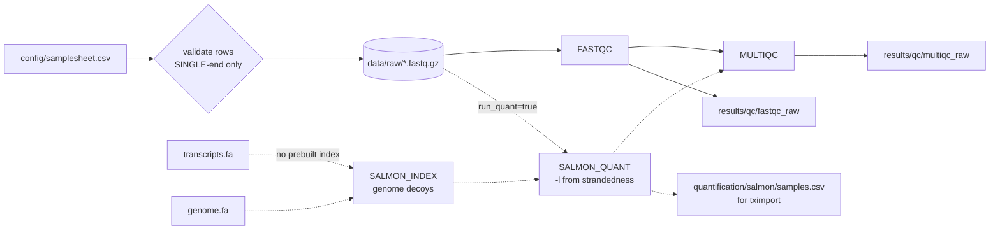

# Nextflow pipeline — `workflow/`

Small DSL2 workflow for this six-sample, **single-end** dataset. Architecture modelled on nf-core/rnaseq 3.27.0 and the Nextflow RNAseq training (sources: `docs/pipeline_sources.md`); it is not a copy of nf-core/rnaseq.

Status (Phase 2): samplesheet validation, FastQC and MultiQC have run on the six real samples (86 s; `-resume` fully cached; `docs/raw_qc_assessment.md`); Salmon index/quant are implemented and stub-tested but **disabled** until the reference decision (D-001) is approved.

## Diagram



Dashed = implemented, not executed on real data. Trimming is intentionally absent (D-003): it would be inserted between the raw FASTQ and Salmon only after an approved QC justification.

## Files

| Path | Content |
|---|---|
| `workflow/main.nf` | Typed `params` block, samplesheet parsing/validation functions, entry workflow, `output {}` block |
| `workflow/modules/fastqc.nf` | `FASTQC` (label `process_low`); reports renamed to the sample ID |
| `workflow/modules/multiqc.nf` | `MULTIQC` (label `process_single`) |
| `workflow/modules/salmon_index.nf` | `SALMON_INDEX` (label `process_high`); full-genome decoys if `--genome_fasta` given |
| `workflow/modules/salmon_quant.nf` | `SALMON_QUANT` (label `process_medium`); single-end `-r`, `--libType` from samplesheet |
| `workflow/nextflow.config` | Output dir, resource caps/labels, reports, `test_stub` profile |
| `workflow/tests/stub/` | Stub samplesheet + `make_fixtures.sh` that generates synthetic fixtures (4 reads/sample, toy FASTA); generated files are git-ignored so no FASTQ is committed |
| `workflow/bootstrap/` | Toy validation workflow (see `docs/nextflow_validation.md`) |

## Running

From the project root with `conda activate stv-rnaseq`:

```bash
# Raw QC (what Phase 2 ran)
nextflow run workflow/main.nf -resume

# Wiring test incl. Salmon, no tools executed
bash workflow/tests/stub/make_fixtures.sh
nextflow run workflow/main.nf -profile test_stub -stub -w work/stub -output-dir /tmp/stv_stub

# FUTURE, only after D-001 approval (example; do not run yet)
# nextflow run workflow/main.nf -resume --run_quant true \
#   --transcript_fasta reference/<approved_transcripts.fa.gz> --genome_fasta reference/<approved_genome.fa.gz>
```

## Parameters (`params` block in `main.nf`)

| Param | Default | Meaning |
|---|---|---|
| `input` | `config/samplesheet.csv` | Samplesheet (relative to `project_dir`) |
| `project_dir` | parent of `workflow/` | Base for relative paths |
| `run_quant` | `false` | Enable Salmon |
| `salmon_index` | `''` | Prebuilt index (skips `SALMON_INDEX`) |
| `transcript_fasta` / `genome_fasta` | `''` | Reference files; **no defaults on purpose** (D-001) |
| `salmon_libtype` | `''` | Global override (e.g. `A`, `SR`); empty = per-sample mapping `auto→A, unstranded→U, forward→SF, reverse→SR` |
| `multiqc_title` | `STV_GSE137303 raw FASTQ QC` | Report title |
| `fastqc_dir`, `multiqc_dir`, `salmon_dir`, `pipeline_info_dir` | `qc/fastqc_raw`, `qc/multiqc_raw`, `quantification/salmon`, `pipeline_info` | Publish paths under `outputDir` (`results/`) |

Biological assumptions (strandedness, reference) live in the samplesheet or parameters, never in process code.

## Samplesheet validation

Before any task is submitted, `readSamplesheet()` checks required columns, unique IDs, `library_layout == SINGLE`, no `fastq_2`, allowed `strandedness`, non-empty `condition`, `.fastq.gz`/`.fq.gz` suffix and that each FASTQ exists. Any violation stops the run with an explicit error.

## Outputs (`outputDir = results`, publish mode `copy`)

| Output | Path | Git |
|---|---|---|
| FastQC HTML + ZIP | `results/qc/fastqc_raw/<sample>_fastqc.{html,zip}` | ignored |
| MultiQC | `results/qc/multiqc_raw/multiqc_report.html`, `multiqc_report_data/` | ignored (2.4 MB, regenerable in ~90 s); small TSV summaries in `results/qc/*.tsv` are tracked |
| Salmon (future) | `results/quantification/salmon/<sample>/` + `samples.csv` index | ignored (with `run_quant=false` an empty `samples.csv` is still written by the output index) |
| Run reports | `results/pipeline_info/` (report, timeline, trace, `software_versions.tsv`) | ignored |

## Resources (personal WSL2 machine: 15 GiB RAM, 20 threads)

`executor.cpus = 12`, `executor.memory = 12 GB`, `process.resourceLimits = [cpus: 12, memory: 12 GB]`; labels: `process_single` 1 CPU / 2 GB, `process_low` 1 CPU / 1 GB (FastQC; `--memory` = 80 % of task memory), `process_medium` 6 CPU / 6 GB (Salmon quant), `process_high` 8 CPU / 12 GB (Salmon index — real requirement with genome decoys unmeasured). `errorStrategy = 'terminate'`.

## Differences from nf-core/rnaseq (and why)

| nf-core/rnaseq 3.27.0 | This workflow | Reason |
|---|---|---|
| Many steps: fq lint, trimming (Trim Galore/fastp default), rRNA removal, STAR/HISAT2, RSeQC, Qualimap, dupRadar, BBSplit, contamination screening… | FASTQC → (SALMON_INDEX → SALMON_QUANT) → MULTIQC | Six samples, two-week project; approved architecture D-002; no trimming without justification (D-003) |
| Paired- and single-end | Single-end only; PAIRED rows rejected | Verified dataset layout; explicit failure is safer than silent support |
| nf-schema plugin + JSON schema for samplesheet/params | Plain Nextflow functions + typed `params` block | No plugin download; enough for 6 rows |
| `strandedness=auto` → Salmon on 1 M subsampled reads, then thresholds 0.8 / 0.1 | `auto` → Salmon `-l A` on all reads; inspect `lib_format_counts.json` of all six (D-004) | Simpler; inspection is a human decision step |
| Containers / per-module conda envs | One pinned conda env on PATH (`stv-rnaseq`); same tool versions as nf-core modules | Docker not available in WSL; single lockable env |
| `publishDir` via `conf/modules.config` | Workflow `output {}` block | Nextflow docs: workflow outputs are intended to replace `publishDir` |
| tximport/DESeq2 QC inside the pipeline | Done later in R scripts (`scripts/R/`) | Keeps statistics outside the workflow; easier to review |
| Versions via topic channel → MultiQC | Same topic-channel pattern → `pipeline_info/software_versions.tsv` | — |
